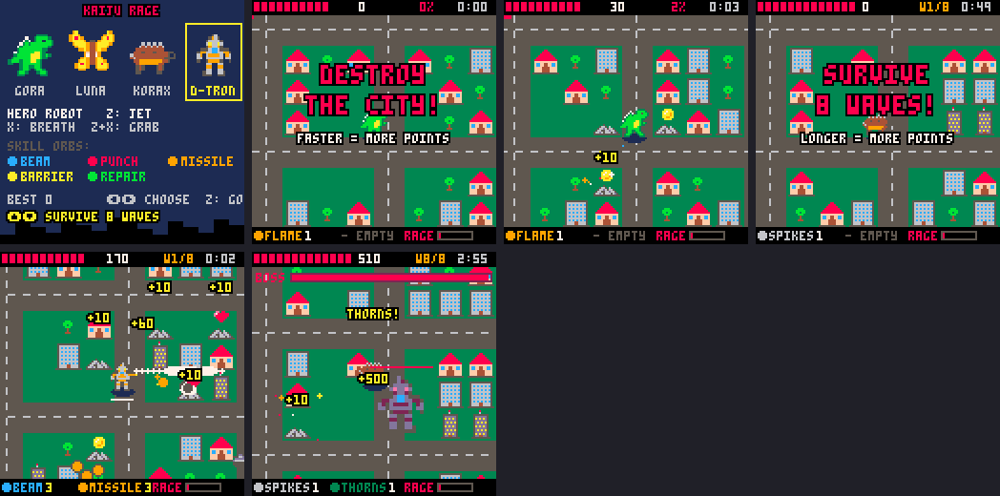
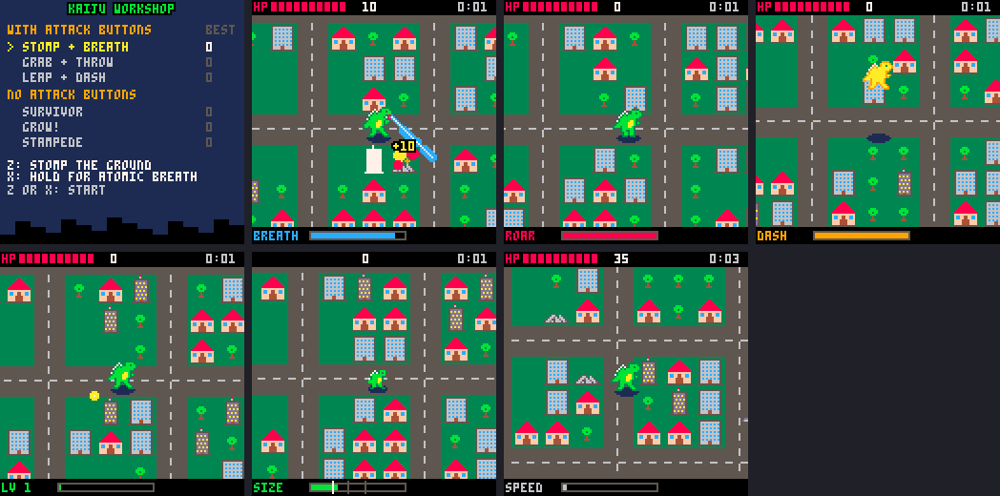
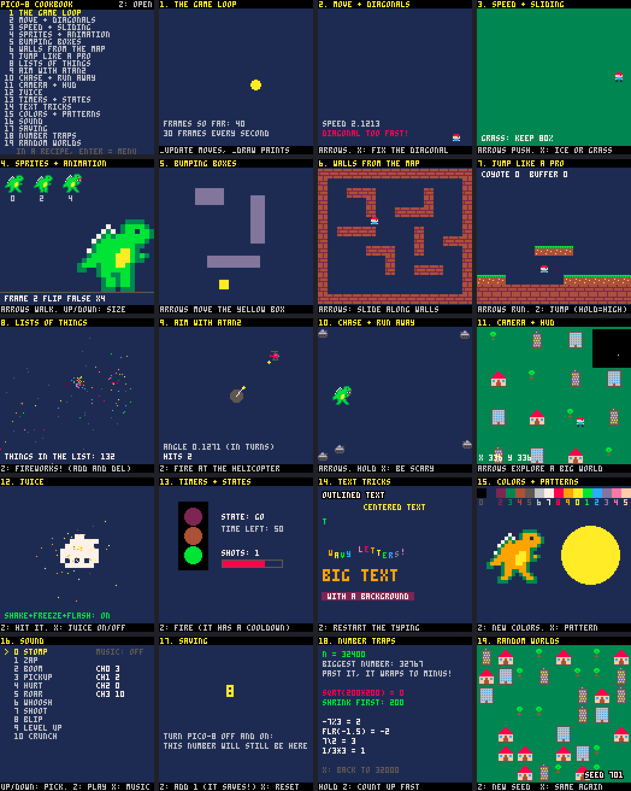

# games

Shalone Cason's PICO-8 games and learning carts.

| folder | what |
|---|---|
| [`cookbook/`](cookbook/COOKBOOK.md) | **PICO-8 Cookbook**: 19 small playable recipes (moving, collisions, jumping, aiming, camera, juice, sound, saving, number traps…) and a guide for learning and teaching them |
| [`kaiju/`](kaiju/WORKSHOP.md) | **Kaiju Workshop**: one monster game played six ways, three with attack buttons and three without, to find the most fun one |
| [`kaiju/rage.p8`](kaiju/RAGE.md) | **Kaiju Rage** (working title): the real game. Breath, stomp/dash/fly, Z+X grab and throw, per-kaiju skill orbs, a rage meter, a rival kaiju, big enemies and mechs |
| [`kaiju/ART_CHECKLIST.md`](kaiju/ART_CHECKLIST.md) | every sprite and sound to draw for Kaiju Rage |
| [`angels/`](angels/IDEAS.md) | notes for the next game: angels lighting up the city |
| `tools/` | helpers: stand-in art, token count, headless test runs, screenshots |

Blessed! and Candles! still live in the sdcourses repo (`game/`).

## Opening them in PICO-8

This folder is linked into PICO-8's carts folder as `games`, so in PICO-8:

```
cd games
cd kaiju
load kaiju
run
```

(`ls` lists what's in a folder, `cd ..` goes back up, `folder` opens the
current folder in Finder.) If `cd games` says it can't find it, the link is
missing; from Terminal:

```bash
ln -s ~/Projects/games ~/Library/Application\ Support/pico-8/carts/games
```

## Art and sound

Everything drawn so far is a **stand-in**, made by `tools/standin_art.py` so
the carts are playable. Draw over it in PICO-8's sprite and sound editors and
save (Ctrl+S): the cart is the source of truth. Don't run `standin_art.py`
on a cart after that, because it replaces the whole sprite sheet and every
sound (it refuses unless you pass `--force`).

## Tools

Run from this folder (needs PICO-8 in /Applications and Python 3, nothing
else):

```bash
python3 tools/tokens.py kaiju/kaiju.p8
```

estimates tokens used (limit 8192).

```bash
python3 tools/smoke.py kaiju/kaiju.p8 kaiju/smoke.lua
```

plays a cart headless with made-up button presses and reports any runtime
error. A driver script can call `shot("name")` to save a screenshot into the
cart's `shots/` folder, and `tools/contact_sheet.py` joins them into one
picture.




