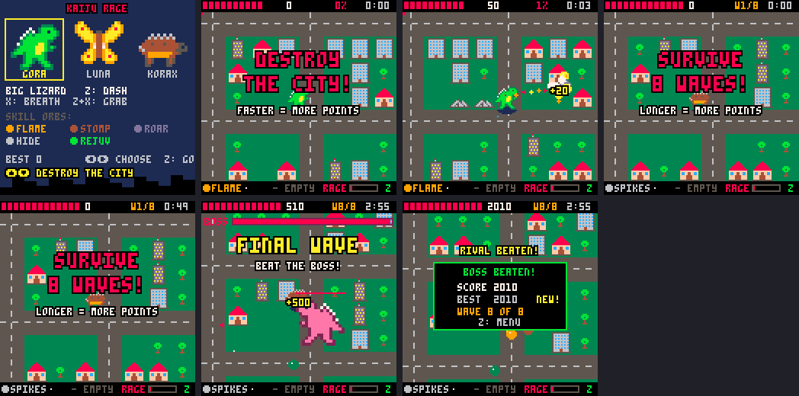

# Kaiju Rage (working title)

The real game, built from the three workshop modes you liked (stomp + breath,
grab + throw, leap + dash) plus a reworked survivor-style skill system.

```
cd games
cd kaiju
load rage
run
```



All art and sounds are stand-ins; the names (Gora, Luna, Korax) are
placeholders too. They're original on purpose: Godzilla, Mothra and the
others are trademarks, so the shipped game needs its own monsters.

---

## Two modes

Pick on the title screen with **up / down** (left / right picks the kaiju).
Each mode starts with its goal in big letters.

| | **destroy the city** | **survive 8 waves** |
|---|---|---|
| goal | wreck **50%** of the city's buildings | last through 8 waves and beat the **boss** in wave 8 |
| on screen | a red **destruction bar** under the top bar, and the % of the goal | **W3/8** at the top; each new wave announced big with "5 waves left" |
| points | everything you smash, plus a **time bonus**: the faster you finish, the more (5 points a second under 5 minutes, ×10 on screen) | everything you smash, plus **500 for every wave** you survive and 1000 for the boss |
| best score | saved per kaiju, per mode | saved per kaiju, per mode |

The army grows the same way in both (a new wave every 25 s); in destroy
mode the waves are just the clock getting meaner.

---

## Controls

| button | does |
|---|---|
| arrows | walk |
| **X** (hold) | breath, in the direction you face. Drains the bar under your feet; let go to refill |
| **Z** | **dash** (walkers) or **fly** (flyers): Z takes off, Z again dives down and stomps |
| **Z + X** together | **grab** what's in front of you: a tank, helicopter, big tank, or a whole building |
| Z or X while holding something | **throw** it |

Z waits 5 frames (a sixth of a second) before dashing or flying, to see if X
comes too. That's what lets Z+X mean "grab" without a third button. Breath
waits the same.

- **Dash:** quick burst, can't be hurt, 3 damage to buildings in the way
  (towers stop you), 1⅓ s cooldown.
- **Fly:** Z takes off; fly over everything for up to 5 s. Tanks, bombs,
  punches and the rival's bite can't reach you up there, but **missiles and
  the rival's fire can**. Z again (or running out of time) dives down:
  whatever you land on is crushed, with a big shockwave. Then a **3 s
  cooldown**. The green "z" in the corner lights up when it's ready.

## The kaiju

| | kaiju | moves | hp | speed | skill orbs |
|---|---|---|---|---|---|
| 1 | **Gora**, big lizard | dash | 10 | medium | flame, stomp, roar, hide, rejuv |
| 2 | **Luna**, giant moth | fly | 8 | fast | gust, spores, zap, dust, cocoon |
| 3 | **Korax**, spiked tank | dash | 13 | slow | spikes, quake, shell, thorns, rock |

Your rule, walkers dash and flyers fly, decides each one's Z move (it's
`z="dash"` or `z="fly"` in the roster, tab 1, so it's one word to change).

## Skill orbs (the survivor part)

Each kaiju has **its own 5 skills**, each a different orb color. They work by
themselves, no buttons. You start with the first one.

- Two **slots**. **Touch an orb and you take it**, bullet-hell style; to
  skip one, dodge it. The **same skill levels up** (up to 3, the dots after
  its name). A new skill fills an empty slot, or else **pushes out your
  weaker skill** (the older one if they're tied), and a banner says what
  happened ("zap for gust").
- Orbs drop from offices and towers (20%), houses (6%), small enemies (8%),
  big enemies (60%), one near you every new wave, and always from a beaten
  rival.

**Gora** (your list):

| orb | color | what it does (gets stronger each level) |
|---|---|---|
| flame | orange | every 1–2 s, a flame jet at the nearest enemy |
| stomp | brown | a shockwave around you every few seconds |
| roar | lavender | every 5–7 s, everything nearby goes **dizzy** (wanders, shoots the wrong way; shows a "?") |
| hide | grey | always on: stone-grey skin, take 20/40/60% less damage (was "rage"; renamed so only rage mode is rage) |
| rejuv | green | always on: heals over time, but you're slower and take 50% more damage |

**Luna:** gust (pushes enemies away, blows away shots) · spores (circle you,
chew buildings, block shots) · zap (lightning at the nearest enemy) · dust
(leaves a cloud that hurts what's in it) · cocoon (heals while standing
still).

**Korax:** spikes (a ring of spikes in every direction) · quake (a big slow
shockwave) · shell (can't be hurt for 2–3½ s, every 6–9 s) · thorns
(getting hit blasts everything around you) · rock (lobs a boulder at the
nearest enemy).

## Rage mode

About a third of what you smash drops a **coin**. 36 coins fill the **rage** meter (about 1–2 times a game),
and it goes off by itself (think Mario's star, or Super Sonic):

- A white flash, a freeze, three shockwaves and a giant wobbling
  **RAGE MODE!**
- For **10 seconds**: you're 1.5× bigger, glowing, cycling through every
  color, with a sparkle trail and its own fast music.
- **Can't be hurt**, 1.5× speed, **double damage and double points**, and
  anything you touch explodes. Breath is free and almost twice as long, in
  rainbow.
- The meter drains as it runs; in the last 2 seconds you blink, so you know
  it's ending.

## The rival kaiju

At 25 seconds another kaiju (one you didn't pick, tinted purple) arrives,
and **it gets stronger every wave**: 10 more hp, faster, harder hits
(1 damage, 2 from wave 3, 3 from wave 6) and more frequent fire.

- It **hunts** you: up close it hits; from a distance it breathes a
  burst of fire at you. It tramples houses as it goes.
- Below **30% hp** it **runs away** and heals; at **70%** it comes back. Its hp
  bar turns blue while it's fleeing.
- Off screen, an **arrow on the edge** points to it: red **!** = hunting,
  blue **+** = running and healing.
- Beat it: 500 points, a pile of coins, and a skill orb. 20 s later a new one
  comes, as strong as the wave it arrives in.

### The boss (survive mode, wave 8)

The rival comes back **twice as big** with **200 hp** (a big bar across the
top of the screen). It never runs away, breathes fire **three ways at once**,
and hits for 3. Beat it to win.

## Waves

A new wave every 25 seconds (each one also drops a skill orb near you); 8 waves, so the final wave comes at about 3 minutes.

| wave | new |
|---|---|
| 1 | tanks, helicopters |
| 2 | (the rival arrives) |
| 3 | **big tanks**: double size, double attack, double defense (2 hp that takes half damage) |
| 4 | **bombers**: double size; fly straight over you and drop bombs that blow up buildings (and other enemies) too |
| 6 | **mechs**: kaiju-sized, 10 hp at double defense, punch up close, fire 3 missiles |
| 8 | **final wave** (survive mode): the boss |

Enemies arrive in **squads** (tanks and helicopters come in groups that grow
with the waves), a new group every 2 s at first and every ⅓ s by the end, up
to **13 enemies at once in wave 1, rising to 48 by wave 8**. The game can
handle about 60 at once without slowing down (it only checks the buildings
near each thing instead of all 300), so this can go higher.

Best score saves per kaiju and mode.

---

## Where things are in the code

| tab | what |
|---|---|
| 0 | setup, title/play/over, **`buttons()`** (all of the Z / X / Z+X logic) |
| 1 | **`roster`** (the kaiju) and **`sk`** (the 15 skills), skill helpers |
| 2 | the city, `hit()` (all damage goes through it) |
| 3 | `upd_play` (skills each frame, rage mode, dash, fly), breath, grab/throw, `hurt` |
| 4 | `et` (enemy stats), `pick()` (which enemy each wave), enemies, bombs, **`rival_ai`** |
| 5 | drops (coins, hearts, orbs), pickups, thrown things, effects |
| 6 | drawing, HUD, title |

### Adding a kaiju

1. Draw 3 sprites of 16 × 16 next to each other (walk 1, walk 2, attack) in a
   free spot, e.g. sprite 100.
2. Add 5 skills to the end of `sk` (copy any; `f` fires and returns the
   frames until the next time, `p` runs every frame).
3. Add a line to `roster` with `sp=100` and its 5 skill numbers.

### Changing an enemy

`et` in tab 0 is one line per enemy: sprite, size, hp, defense (also its
attack), speed, points. Defense 2 means it takes half damage and hits for 2.

### Room left

About **7,840 of 8,192 tokens** are used: nearly full. A fourth kaiju or
more skills would mean trimming something first (there's room to: some
helpers can be merged, and the title screen could get simpler). Ask me
when you get there.

## Sprite numbers (new in this cart)

| sprite | what |
|---|---|
| 0 / 2 / 4 | Gora: walk, walk, attack |
| 64 / 66 / 68 | Luna |
| 70 / 72 / 74 | Korax |
| 76 | big tank (16 × 16) · 78 bomber (16 × 16) |
| 96 / 98 | mech walk frames (16 × 16) |
| 41 | coin |

The rest are the same as the workshop (buildings, tank, helicopter, shells,
tree, heart).

## Testing

```bash
python3 tools/smoke.py kaiju/rage.p8 kaiju/rage_smoke.lua
```

plays all three kaiju in both modes (grab, breath, the Z move, orbs, rage
mode, the late waves) through to a win: the city destroyed, or the boss
beaten. `kaiju/rage_shots.lua` retakes the screenshots and
`kaiju/rage_sim.lua` (add `300` to the command) has a bot play whole games
to check the pacing. The test scripts are kept tiny because the test runner adds
its code to the cart, and the cart is near the token limit.
