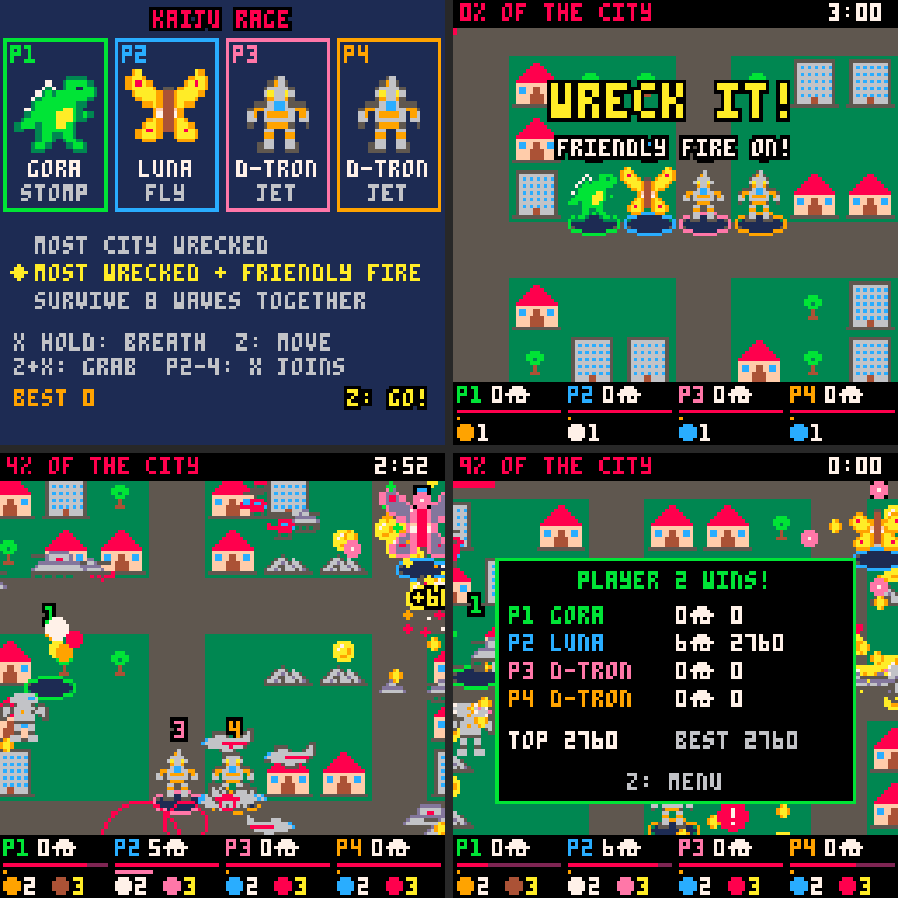

# Kaiju Rage (working title)

The real game, built from the three workshop modes you liked (stomp + breath,
grab + throw, leap + dash) plus a reworked survivor-style skill system.

```
cd games
cd kaiju
load rage
run
```


All art and sounds are stand-ins; the names (Gora, Luna, Korax; D-Tron is yours) are
placeholders too. They're original on purpose: Godzilla, Mothra and the
others are trademarks, so the shipped game needs its own monsters.

---

## Two modes

Pick on the title screen with **up / down** (left / right picks the kaiju).
Each mode starts with its goal in big letters.

| | **destroy the city** | **survive 8 waves** |
|---|---|---|
| goal | wreck **50%** of the city's buildings | last through 8 waves and beat the **boss** in wave 8 |
| on screen | a red **destruction bar** under the top bar, the % of the goal, and an orange **house marker** on the screen edge pointing to the nearest building left, whenever none is close | **W3/8** at the top; each new wave announced big with "5 waves left" |
| points | everything you smash, plus a **time bonus**: the faster you finish, the more (5 points a second under 5 minutes, ×10 on screen) | everything you smash, plus **500 for every wave** you survive and 1000 for the boss |
| best score | saved per kaiju, per mode | saved per kaiju, per mode |

The army grows in waves in both. In survive mode a new wave comes every
25 s; in **destroy mode the waves follow how wrecked the city is**: about
every 11% is a new wave, so at **about 80% the final wave comes**, with the
boss and the screen full of big tanks and mechs. Destroying fast doesn't
leave the army behind. In destroy mode, beating the boss also wins.

---

## Controls

| button | does |
|---|---|
| arrows | walk |
| **X** (hold) | breath, in the direction you face. Drains the bar under your feet; let go to refill |
| **Z** | **stomp** (Gora), **dash** (Korax) or **fly** (Luna): Z takes off, Z again dives down and stomps |
| **Z + X** together | **grab** what's in front of you: a tank, helicopter, big tank, or a whole building |
| Z or X while holding something | **throw** it |

Z waits 5 frames (a sixth of a second) before its move, to see if X
comes too. That's what lets Z+X mean "grab" without a third button. Breath
waits the same.

**Z charges back.** A green bar under your feet (under the breath bar) shows
the charge; it fills while you're on the ground. Z works any time, but only
as strong as the charge (at least 30%): use it again too soon and you get a
shorter dash, a lower hop, a shorter flight and a smaller landing. A full
charge takes about 2 s (Gora), 1⅓ s (Korax), 4 s (Luna).

- **Stomp** (Gora): he rears up (stretches tall, a little off the ground)
  and slams down: crushes what's under him, with a shockwave. He squashes
  wide when he lands. No new drawing needed; if you'd like a "foot up" pose,
  that's a sprite to add later.
- **Dash** (Korax): quick burst, can't be hurt, 3 damage to buildings in the
  way (towers stop you).
- **Jet** (D-Tron): like fly, but short hops of up to 1½ s that charge back
  twice as fast.
- **Fly** (Luna): Z takes off; fly over everything for up to 3 s. Tanks,
  bombs, punches and the rival's bite can't reach you up there, but
  **missiles and the rival's fire can**. Z again (or running out of time)
  dives down: whatever you land on is crushed, with a shockwave.

## The kaiju

| | kaiju | moves | hp | speed | skill orbs |
|---|---|---|---|---|---|
| 1 | **Gora**, big lizard | stomp | 10 | medium | flame, tail, roar, hide, rejuv |
| 2 | **Luna**, giant moth | fly | 8 | fast | gust, spores, zap, dust, cocoon |
| 3 | **Korax**, spiked tank | dash | 13 | slow | spikes, quake, shell, thorns, rock |
| 4 | **D-Tron**, hero robot | jet | 11 | medium | beam, punch, missile, barrier, repair |

Each one's Z move is `stomp`, `dash`, `fly` or `jet` in the roster (tab 1),
one word to change; `zr` is how fast it charges back and `zt` how long it
stays up. D-Tron's breath (X) is white, so it reads as a beam.

## Skill orbs (the survivor part)

Each kaiju has **its own 5 skills**, each a different orb color. They work by
themselves, no buttons. You start with the first one.

- Two **slots**. **Touch an orb and you take it**, bullet-hell style; to
  skip one, dodge it. The **same skill levels up** (up to 3; the number after
  its name, yellow at max). A new skill fills an empty slot, or else **pushes out your
  weaker skill** (the older one if they're tied), and a banner says what
  happened ("zap for gust").
- **Level 2 and 3 skills are safe.** Once your weaker skill is level 2 or
  more, touching a different orb does nothing by accident. To swap anyway,
  **stand on the orb for one second**: a small bar in the orb's color climbs
  beside you with the skill's name ("roar?"), and when it's full the swap
  happens. Walk off and it resets.
- **Orbs for skills you already have fly to you** from about 3 houses away,
  so a level-up is never lost in the crowd.
- Orbs drop from offices and towers (20%), houses (6%), small enemies (8%),
  big enemies (60%), one near you every new wave, and always from a beaten
  rival. Once you have two skills those chances drop to about a sixth
  (`.15` in `drop()`, tab 5), because orbs that fly to you and skills that
  can't be lost would otherwise level you twice as fast. Measured with a bot:
  both skills reach level 3 at about the same time as before (a bit over
  2 minutes).

**Gora** (your list):

| orb | color | what it does (gets stronger each level) |
|---|---|---|
| flame | orange | every 1–2 s, a flame jet at the nearest enemy |
| tail | brown | a tail sweep: a shockwave around you every few seconds (was 'stomp'; renamed now that stomp is his Z move) |
| roar | lavender | every 5–7 s, everything nearby goes **dizzy** (wanders, shoots the wrong way; shows a "?") |
| hide | grey | always on: stone-grey skin, take 20/40/60% less damage (was "rage"; renamed so only rage mode is rage) |
| rejuv | green | always on: heals over time, but you're slower and take 50% more damage |

**Luna:** gust (pushes enemies away, blows away shots) · spores (circle you,
chew buildings, block shots) · zap (lightning at the nearest enemy) · dust
(leaves a cloud that hurts what's in it) · cocoon (heals while standing
still).

**Korax:** spikes (a ring of spikes in every direction) · quake (a big slow
shockwave) · shell (can't be hurt for 2–3½ s, every 6–9 s) · thorns
(getting hit blasts everything around you) · rock (lobs a boulder at the
nearest enemy).

**D-Tron:** beam (a long laser line at the nearest enemy) · punch (a rocket
fist that flies at the nearest enemy and blows up) · missile (1, 2, then 3
at once) · barrier (can't be hurt for 2½–4 s, every 10–11 s) · repair (heals
over time, no slowdown).

## Rage mode

About a third of what you smash drops a **coin** (two thirds in destroy mode, which is shorter, so rage comes there too). 36 coins fill the **rage** meter (about 1–2 times a game),
and it goes off by itself (think Mario's star, or Super Sonic):

- A white flash, a freeze, three shockwaves and a giant wobbling
  **RAGE MODE!**
- For **10 seconds**: you're 1.5× bigger, glowing, cycling through every
  color, with a sparkle trail and its own fast music.
- **Can't be hurt**, 1.5× speed, **double damage and double points**, and
  anything you touch explodes. Breath is free and almost twice as long, in
  rainbow.
- The meter drains as it runs; in the last 2 seconds you blink, so you know
  it's ending.

## The rival kaiju

At 25 seconds (10 in destroy mode) another kaiju (one you didn't pick, tinted purple) arrives,
and **it gets stronger every wave**: 10 more hp, faster, harder hits
(1 damage, 2 from wave 3, 3 from wave 6) and more frequent fire.

- It **hunts** you: up close it hits; from a distance it breathes a
  burst of fire at you. It tramples houses as it goes.
- Below **30% hp** it **runs away** and heals; at **70%** it comes back. Its hp
  bar turns blue while it's fleeing.
- Off screen, an **arrow on the edge** points to it: red **!** = hunting,
  blue **+** = running and healing.
- Beat it: 500 points, a pile of coins, and a skill orb. 20 s later a new one
  comes, as strong as the wave it arrives in.

### The boss (wave 8, both modes)

The rival comes back **twice as big** with **200 hp** (a big bar across the
top of the screen). It never runs away, breathes fire **three ways at once**,
and hits for 3. Beat it to win.

## Waves

A new wave every 25 seconds in survive mode (about 3 minutes to the final wave), or every ~11% of the city in destroy mode. Each one also drops a skill orb near you.

| wave | new |
|---|---|
| 1 | tanks, helicopters |
| 2 | (the rival arrives) |
| 3 | **big tanks**: double size, double attack, double defense (2 hp that takes half damage) |
| 4 | **bombers**: double size; fly straight over you and drop bombs that blow up buildings (and other enemies) too |
| 6 | **mechs**: kaiju-sized, 10 hp at double defense, punch up close, fire 3 missiles |
| 8 | **final wave**: the boss. By now about 1 in 5 new enemies is a mech and most of the rest are big |

Enemies arrive in **squads** (tanks and helicopters come in groups that grow
with the waves), a new group every 2 s at first and every ⅓ s by the end, up
to **16 enemies at once in wave 1, rising to 58 by wave 8**. Later waves
send bigger things more often (big tanks, bombers and mechs make up about a
quarter of new enemies in wave 4 and two thirds in wave 8). The game can
handle about 60 at once without slowing down (it only checks the buildings
near each thing instead of all 300), so this can go higher.

Best score saves per kaiju and mode.

---

## Where things are in the code

| tab | what |
|---|---|
| 0 | setup, title/play/over, **`buttons()`** (all of the Z / X / Z+X logic) |
| 1 | `tbl()`, **`roster`** (the kaiju) and **`sk`** (the 20 skills), `skill()` and `fire()` (what skills do), helpers |
| 2 | the city, `hit()` (all damage goes through it) |
| 3 | `upd_play` (skills each frame, rage mode, dash, fly, stomp), `zmove`, breath, grab/throw, `hurt` |
| 4 | `et` (enemy stats), `pick()` (which enemy each wave), enemies, bombs, **`rival_ai`** |
| 5 | drops (coins, hearts, orbs), pickups, thrown things, effects |
| 6 | drawing, HUD, title |

### How the kaiju and skills are written (tab 1)

The roster and all 20 skills are **tables written as text**: one line per
kaiju or skill, with the field names on the first line. `tbl()` turns the
text into tables. PICO-8 counts a whole string as 1 token, so this is much
cheaper than writing `{n="gora",hp=10,...}`, and it's easy to read and edit.

Each skill line is: name, orb color, **what it does** (`a`), cooldown and
how much shorter each level (`cd`, `cl`), size and how much bigger each level
(`r`, `rl`), damage or time and how much more each level (`d`, `dl`), and an
extra number (`x`). What it does is one of the shared actions:

| `a` | does | used by |
|---|---|---|
| `ray` | a line of hits toward the nearest enemy, `r` long | flame, beam |
| `nova` | a shockwave around you, `r` wide | tail, quake |
| `lob` | thrown at the nearest enemy, blows up `r` wide; `x` = how many per level (0 = one) | rock, punch, missile |
| `zap` | lightning on the nearest enemy | zap |
| `spikes` | `x` per level, out in every direction | spikes |
| `dizzy` | enemies near you wander for `d` frames | roar |
| `gust` | pushes enemies `d` away, blows away shots | gust |
| `dust` | a cloud that hurts, `d` frames | dust |
| `shell` | can't be hurt for `d` frames | shell, barrier |
| `pass` | always on: armor ×(`r`+`rl`×level), speed ×`d`, heals `dl`×level a frame (`x`=1: only standing still) | hide, rejuv, cocoon, repair |
| `orbit` | spores circling you | spores |
| `thorn` | getting hit blasts everything near | thorns |

So a new skill that works like an old one is **just a new line of numbers**.
A new kind of action is a new `elseif` in `fire()` (or `skill()` for
always-on ones).

### Adding a kaiju

1. Draw 3 sprites of 16 × 16 next to each other (walk 1, walk 2, attack) in a
   free spot, e.g. sprite 106.
2. Add 5 lines to the end of `sk` (its skills, in order).
3. Add a line to `roster` with its sprite number. Its skills are found by
   position: the 5th kaiju gets skills 21–25.
4. The title screen fits 4; a 5th needs the boxes made narrower in
   `drw_title()`.

### Changing an enemy

`et` in tab 0 is one line per enemy: sprite, size, hp, defense (also its
attack), speed, points. Defense 2 means it takes half damage and hits for 2.

### Room left

About **7,917 of 8,192 tokens** are used (`sh tools/realtokens.sh
kaiju/rage.p8` asks PICO-8 itself). The text tables freed about 270 even
after adding D-Tron. A new kaiju whose skills reuse the shared actions costs
only its drawings; a new kind of action costs about 20–50 tokens.

## Sprite numbers (new in this cart)

| sprite | what |
|---|---|
| 0 / 2 / 4 | Gora: walk, walk, attack |
| 64 / 66 / 68 | Luna |
| 70 / 72 / 74 | Korax |
| 100 / 102 / 104 | D-Tron |
| 76 | big tank (16 × 16) · 78 bomber (16 × 16) |
| 96 / 98 | mech walk frames (16 × 16) |
| 41 | coin |

The rest are the same as the workshop (buildings, tank, helicopter, shells,
tree, heart).

## Testing

```bash
python3 tools/smoke.py kaiju/rage.p8 kaiju/rage_smoke.lua
```

plays all four kaiju in both modes (grab, breath, the Z move, orbs, rage
mode, the late waves) through to a win: the city destroyed, or the boss
beaten. `kaiju/rage_shots.lua` retakes the screenshots and
`kaiju/rage_sim.lua` (add `300` to the command) has a bot play whole games
to check the pacing, and `kaiju/rage_levels.lua` (add `580`) measures how
fast skills level up, `kaiju/rage_coins.lua` (add `580`) how many coins and rages a game gives, and `kaiju/rage_skills.lua` (add `200`) fires every skill at level 3. The test runner adds its code to the cart, and the
cart is near the token limit, so a test's first line can say
`-- stub: name name` to empty functions it doesn't need (only in the test
copy, never in the cart).

---

## 4 players (rage4.p8)

Its own cart, like Blessed! 4, so the 1-player game keeps its room:

```
cd games
cd kaiju
load rage4
run
```



**Joining:** player 1 is always in. Players 2–4 press **X** on their own
controller to join. Everyone picks a kaiju with **left / right** (two people
can pick the same one; your color ring and number tell you apart). Player 1
picks the mode with **up / down** and starts with Z or X.

| mode | goal | when it ends |
|---|---|---|
| **most city wrecked** | wreck the most buildings (points break a tie). The army comes too | after 3 minutes, or when half the city is down |
| **most wrecked + friendly fire** | the same, but your breath, stomps, throws and skills hurt the others too (half damage). A knockout pays 300 | the same |
| **survive 8 waves together** | no friendly fire; beat the boss in wave 8 | the boss is beaten, or everyone is down |

- **Going down:** in the wrecking modes you're back in 3 seconds with full hp.
  In survive, you're out until the next wave, then back with half hp.
- **One screen:** the camera follows the middle of the group, and nobody can
  walk off the screen, so stick together.
- **Skill orbs** belong to a kaiju: Gora's orbs are only for Goras. Each new
  wave drops one near every player. Coins and hearts are for anyone.
- **Bottom bar**, one column per player: buildings wrecked (or points in
  survive), hp (red), rage (orange) and the two skills with their levels.
  Skill names show in the message when you get or level one ("p2 zap level 2").
- Enemies go after the nearest kaiju. The rival and the boss have more hp
  with more players (×2.5 for 4).
- Best score per mode: the winner's points (wrecking) or the team's (survive).

**Left out to fit** (the cart is at 8,165 of 8,192 tokens): the rival doesn't
run away to heal, helicopters don't circle, stomps don't freeze the screen
(with 4 kaiju the freezes piled up), no marker for the nearest building,
lightning is one zig-zag, and no big "rage mode!" letters. The army tops out
at 50 at once (58 in the 1-player game) so four kaiju breathing at once stay
smooth.

**Same drawings and sounds as rage.p8.** The code is in `kaiju/rage4.lua`;
after you redraw art or change sounds in rage.p8, rebuild the 4-player cart
so it gets them:

```bash
python3 tools/cart4.py kaiju/rage4.lua kaiju/rage.p8 kaiju/rage4.p8
```

(Don't edit rage4.p8's code in PICO-8: it's remade from rage4.lua.)

**Testing:** `kaiju/rage4_smoke.lua` (add `240`) plays all three modes with
four players mashing buttons, friendly-fire knockouts, coming back, the boss
and everyone down; `kaiju/rage4_shots.lua` retakes the screenshots;
`kaiju/rage4_cpu.lua` measures the busiest frames (four kaiju breathing
non-stop, level 3 skills, a full army: about half of PICO-8's time on
average, 92% at worst).
