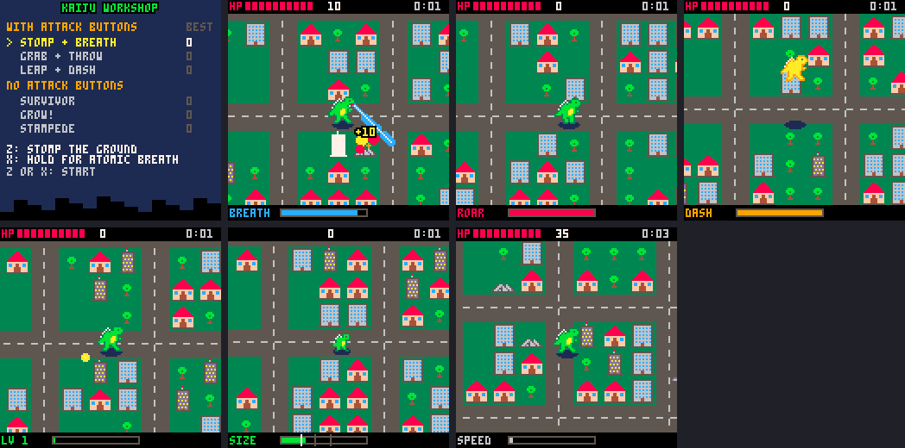

# Kaiju Workshop

One monster, one city, one army, **six ways to play**. `kaiju.p8` is a
sketchbook for finding out which kind of kaiju game is the most fun before
building the real one. Three modes use attack buttons, three use none
(you only steer).

```
cd games
cd kaiju
load kaiju
run
```

Pick a mode on the title screen. Your best score for each mode is saved.

All art and sounds are **stand-ins** (drawn by `tools/standin_art.py`). Redraw
anything in the sprite and sound editors under the same sprite numbers and
everything keeps working.



---

## The six modes

| | mode | Z | X | buildings | what makes it fun |
|---|---|---|---|---|---|
| 1 | **stomp + breath** | stomp (area hit) | hold: atomic breath | solid: smash them | classic power fantasy; aim the beam |
| 2 | **grab + throw** | grab, then throw | roar (stun + push) | solid: rip them out | physical, puzzly; the city is your ammo |
| 3 | **leap + dash** | leap (immune in air, crush on landing) | dash (immune, breaks small buildings) | solid unless you dash/leap | fast and acrobatic; timing |
| 4 | **survivor** | – | – | trample small ones | weapons fire themselves; level up by gems |
| 5 | **grow!** | – | – | eat what's smaller | start tiny, end huge; size *is* health |
| 6 | **stampede** | – | – | ram at speed | momentum; drifting turns; fast = invincible |

### 1. Stomp + breath

- **Z** stomps: everything within 14 pixels of your feet takes 2 damage, with
  a shockwave ring, screen shake and a tiny hit-stop.
- **Hold X** for atomic breath in the direction you're facing (8 directions).
  It grows longer while held and drains the blue meter; you walk slowly while
  breathing. At empty it sputters.
- Buildings are solid: you have to destroy them to get through.

*Feel:* the most "Godzilla" one. Good first mode. The beam makes facing
matter; the stomp is the panic button when tanks get close.

*Remix ideas:* charge the stomp by holding Z; let the beam set buildings on
fire (they lose 1 hp a second); make the beam sweep with the arrows.

### 2. Grab + throw

- **Z** grabs what's right in front of you: a tank, a helicopter, or a whole
  building (which comes up in one piece over your head). **Z** again throws
  it; it lands where it's headed (or early, if it hits an enemy) and blasts
  everything around.
- **X** roars (every 5 seconds): enemies within 48 pixels get pushed back and
  stunned for 4 seconds, and their shots in the air vanish.
- Buildings are solid.

*Feel:* slower and more thoughtful. Every throw is a choice: hold onto that
tower for a big group, or throw it now?

*Remix ideas:* throwing a tank at a tank chains; heavier things fly shorter;
roar could knock buildings down too.

### 3. Leap + dash

- **Z** leaps: one second in the air, invincible, over anything. Landing
  crushes whatever is under your feet and blasts the area around.
- **X** dashes: a burst of speed, invincible, 3 damage to every building you
  hit. Houses and offices break; towers stop you cold.
- Steer in the air.

*Feel:* the most action-game. Both buttons are also dodges, so good players
weave through missiles. The shadow on the ground shows where you'll land.

*Remix ideas:* a dash into a leap = a long jump; a combo counter for chains of
landings; a ground-pound that's stronger the higher you jumped.

### 4. Survivor (no buttons)

You only steer. Weapons fire by themselves:

- **Zap:** lightning strikes the nearest enemy within 64 pixels.
- **Spores:** yellow balls circle you, chewing buildings and blocking shots.
- **Pulse:** (after the first level-up) a shockwave every few seconds.

Things you destroy drop **gems**. Each level-up improves one weapon, in turn:
pulse, more spores, faster zap, …. You trample trees, houses and tanks just by
walking; offices and towers are solid until your weapons wear them down.

*Feel:* relaxing, then hectic. Where you walk is the whole game.

*Remix ideas:* choose the upgrade (pause and pick 1 of 3); weapons from
different kaiju; a magnet that pulls gems in.

### 5. Grow! (no buttons)

- You start small. Walk into anything **smaller than you** to eat it and grow:
  houses at size .6, offices at 1.0, towers at 1.5 (the white marks on the
  size meter). Bigger things just bounce you.
- Tanks get squashed from size .8, helicopters from 1.3.
- **Getting hit shrinks you.** Below .45 it's over. Hearts grow you a bit.
- You get slower as you get bigger.

*Feel:* the clearest goal of any mode (get to towers!), and the city changes
from scary to snack.

*Remix ideas:* the camera zooms out as you grow (draw everything with
`sspr` at a scale); a size you have to reach before a timer runs out.

### 6. Stampede (no buttons)

- The arrows **push** you; you keep sliding (friction .97, like ice). Turning
  takes a wide drift.
- Over speed 2 you smash houses and offices; over 2.6 even towers. Slower than
  that, buildings bounce you back and only chip.
- Over 2.5 you glow gold and can't be hurt. Tanks and helicopters get run over
  above 1.5.

*Feel:* skillful and very different: you plan your lines down the streets,
like a racing game.

*Remix ideas:* boost pads on the roads; a combo that grows while you never
drop below speed 2; a skid mark trail.

---

## How the code is laid out

| tab | what | you'll find |
|---|---|---|
| 0 | setup + game states | `_update`/`_draw` pick title, play or over; `start()` resets a run; `cartdata` best scores |
| 1 | the city | `make_city`, `dist` (overflow-safe), `bump` (what the feet touch), `smash`, `hit` |
| 2 | the kaiju | `upd_play` (reading the arrows, diagonals, friction), `move_k` (one axis at a time), `crush`, `hurt` |
| 3 | army + effects | spawning, tanks and helicopters, shots and homing missiles, `kill`, `drop`, particles, rings, score |
| 4 | modes with buttons | modes 1–3, plus `grab` |
| 5 | modes with no buttons | modes 4–6, plus `spore`, `bolt`, `speed` |
| 6 | drawing + hud | camera, roads, buildings behind/in front of the kaiju, HUD, title, game over |

### The one idea that makes six modes cheap

Every mode is **a table of small functions**, and the shared game asks the
mode what to do at the moments that differ:

```lua
add(modes,{
 name="grow!",
 desc="...",               -- title screen
 init=function() ... end,  -- start of a run
 upd=function() ... end,   -- every frame (buttons, weapons)
 drw=function() ... end,   -- extra drawing (beam, spores)
 hud=function() ... end,   -- the bottom bar
 crush=function(b) ... end,-- walked into building b: break it?
 eat=function(e) ... end,  -- touched enemy e: squash it?
 hurt=function(n) ... end, -- got hit (default: lose hp)
 heal=function() ... end,  -- picked up a heart
 gem=function() ... end,   -- picked up a gem (gems only drop if this exists)
 acc=.09,fric=.97,bounce=.7, -- movement feel (default 1.2, 0, 0)
 nohp=true,                -- hide the hp bar
})
```

Everything optional falls back to a default. All damage goes through one
function, `hit(x,y,r,damage)`, which hurts every building and enemy in a box:
the stomp, the beam, a thrown tank, the spores and the landing are all just
`hit` with different numbers.

### Make a seventh mode

1. Copy the smallest mode (grow!) to the end of tab 5.
2. Change `name` and `desc`. It appears on the title screen by itself.
3. Change one rule. Ideas: a **tail swipe** (`btnp(4)`: `hit` both sides of
   you); **two kaiju** (player 2 uses `btn(b,1)`); a **night city**
   (`pal()` swaps before drawing); a **pacifist** mode where the army can only
   hurt itself (make shots `hit` what they land on).
4. Its best score saves automatically in slot 7.

---

## Numbers to tweak

| what | where | now |
|---|---|---|
| world size | tab 0 `world` | 384 (6 × 6 blocks) |
| building hp / points | tab 0 `bhp`, `bpts` | tree 1/1, house 1/10, office 3/25, tower 6/50 |
| kaiju hp | `start()` | 10 |
| walk speed | `upd_play` default `acc` | 1.2 |
| how fast the army grows | `upd_army` | a new wave every 30 s; more, faster, more helicopters |
| hearts / gems | `drop` | 6% heart, 39% gem (gem modes only) |
| how hard you get hit | `hurt` | 1 hp, then 1 second of blinking |

## Sprite numbers

| sprite | what |
|---|---|
| 0, 2 | kaiju walk frames (16 × 16) |
| 4 | kaiju attacking (mouth open) |
| 6, 8, 10 | house, office, tower (16 × 16) |
| 12 | rubble (16 × 16) |
| 32 | tank · 33, 34 helicopter frames |
| 35 | shell · 36 missile |
| 37 | tree · 38 car (unused) · 39 gem · 40 heart |
| 46, 47 | brick and grass (cookbook only) · 48, 49 little hero (cookbook) |

Sounds: 0 stomp, 1 zap/beam, 2 boom, 3 pickup, 4 hurt, 5 roar, 6 whoosh,
7 enemy shot, 8 menu blip, 9 level up, 10 crunch; 16 + 17 are the music loop.

---

## Ideas carried over from the first version

The first (Gemini) version had more around the edges. All of these would fit
in the token budget (this cart uses about 4,900 of 8,192):

- A **rival kaiju** that hunts you, retreats to heal below 30% hp, with an
  arrow at the screen edge pointing to it.
- A **countdown** to a big finale.
- **Biomes**: the same city with different palettes and a sea to wade in.
- A **roster** of kaiju unlocked by lifetime points (careful with 32767!
  see cookbook recipe 18).
- A **wrap-around world** (walk off the right, appear on the left).

## Testing without opening PICO-8

From the `games` folder:

```bash
python3 tools/smoke.py kaiju/kaiju.p8 kaiju/smoke.lua
```

plays every mode for a while with made-up button presses and reports any
error. `kaiju/shots.lua` saves a screenshot of each mode to `kaiju/shots/`.
`python3 tools/tokens.py kaiju/kaiju.p8` estimates the token count.
